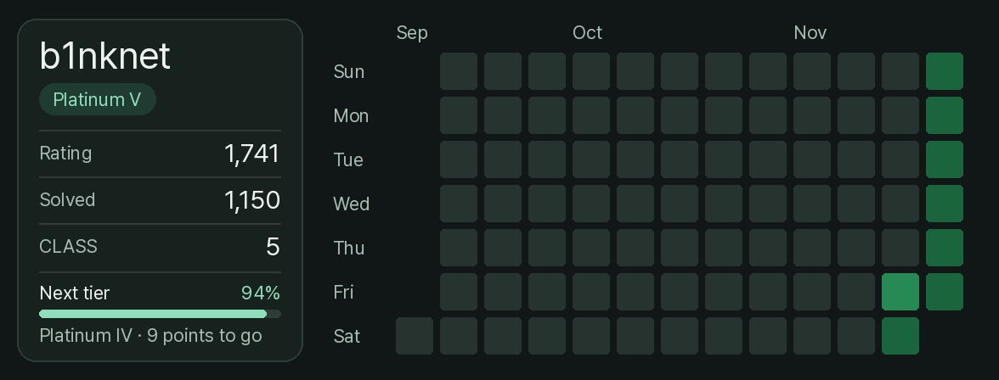

# solved

**백준 문제 풀이 저장소**

 &nbsp;
 &nbsp;
 &nbsp;

<!-- solvedac:stats:start -->

rate: **1741** | solved: **1149** | class: **5**

저장된 문제 수: **7**

업데이트: 26.11.25. 14:54:26 (KST)

<!-- solvedac:stats:end -->

<!-- solvedac:problems:start -->

| 번호 | 제목 | 레벨 | 코드 |
|:---:|:---:|:---:|:---:|
| [2875](https://solved.ac/p/2875) | 대회 or 인턴 |  |  |
| [2953](https://solved.ac/p/2953) | 나는 요리사다 |  |  |
| [10102](https://solved.ac/p/10102) | 개표 |  |  |
| [10103](https://solved.ac/p/10103) | 주사위 게임 |  |  |
| [10991](https://solved.ac/p/10991) | 별 찍기 - 16 |  |  |
| [20053](https://solved.ac/p/20053) | 최소, 최대 2 |  |  |
| [24265](https://solved.ac/p/24265) | 알고리즘 수업 - 알고리즘의 수행 시간 4 |  |  |

<!-- solvedac:problems:end -->

